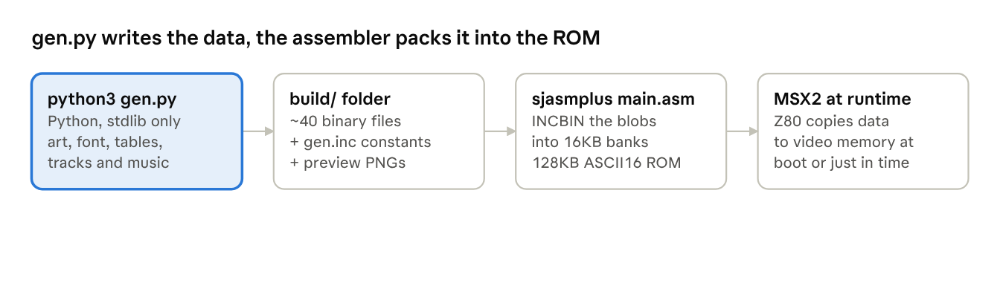

# How gen.py Builds Dune Hopper's Assets

Nov 14, 2026 · Jzzy & Claude

One Python script, `gen.py`, produces everything in Dune Hopper that isn't code: graphics, font, perspective tables, tracks and music. No image editor or music tracker was used; every pixel, table entry and note comes from code. Running it again gives exactly the same output, and changing a number in the script followed by a rebuild changes the game.

## The pipeline

`gen.py` writes about 40 small binary files into `build/`, plus `gen.inc`, a text file of constants such as `BAND_Y equ 58`. The assembler pulls the files in with `INCBIN`, reads the constants with `INCLUDE`, and places each blob in the right 16KB ROM bank. At boot, or just before a falling object appears, the Z80 copies the data into video memory. Only Python's standard library does the work; PIL is used just to save preview PNGs.

## Graphics: images as lists of numbers

An image in the script is a plain 2D list of palette numbers 0–15, which is screen 5's 16-colour mode. Colour 0 is transparent.

Everything is drawn with small helpers: `put`, `rect`, `ellipse`, `poly` (fill a polygon), `thick_line`, and `outline`, which adds a dark edge around a shape. Each object is a function. For example, `art_tree()` draws a brown trunk, stacks four green ellipses for the canopy, darkens the right-hand edges for shading, and adds a few yellow highlight dots. Rocks, logs, stars, warning signs, gate posts and the ten falling objects (`d_ufo()` to `d_piano()`) work the same way.

Three steps turn a drawing into game data:

1. **Pre-scaling:** each object is shrunk to 8 sizes, each 75% of the one before (1, 0.75, 0.56 … 0.13). The MSX can't scale images itself, so distant objects use a smaller pre-made copy.
2. **Packing:** all sizes are fitted onto one 256-pixel-wide sheet, tallest objects first, filling rows left to right. The script records where each copy landed in `objinfo.bin` (x, y, width, height). The assembly code looks up "object type T at size K" there and copies that rectangle to the screen with the video chip's copy command. An `assert` stops the build if the sheet overflows its space in video memory.
3. **Encoding:** screen 5 stores 2 pixels per byte (`pack4`), then the result is run-length encoded (`rle`). A control byte below 128 means "the next n+1 bytes are literal"; 128 or more means "repeat the next byte n−127 times". The decoder in assembly is about 20 lines and writes straight to the video chip, so nothing is unpacked into the MSX's small RAM.

## The road and the moving stripes

The road is pre-drawn as 116 horizontal lines, one per screen row from the horizon down. For row r, the script computes the distance z = 4096 / (r + 4). From that it gets the road's half-width, the white edge width and the grassy centre strip, all growing towards the bottom of the screen.

The moving stripes are also set up here. Each row gets a stripe phase 0–3 based on its distance, and is coloured with palette entries 1–4 (grass) and 5–8 (dirt) according to that phase. During play the game never redraws those rows to animate the stripes. It only changes which of those 8 palette entries are light and which are dark, 50 or 60 times a second. That costs 16 bytes per frame and gives smooth motion.

## Sky, font, title and buggy

- **Sky:** the mountain ridge is a sum of sine waves with whole-number frequencies, so it joins up seamlessly after 256 pixels. The sideways parallax scrolling in curves depends on that. The clouds sit above the scrolling band, so they stay still.
- **Font:** each character is typed directly into the script as seven 5-character strings, with `#` for a lit pixel. That's how the "&" for the subtitle was added.
- **Title logo:** built from the same font, scaled up 3×, slanted by one pixel per row, coloured yellow fading to red with a black outline, and painted over the sky image. The "BY JZZY & CLAUDE - 2026" line is added the same way at normal size.
- **Buggy sprite:** drawn as ASCII art, one character per pixel (`W` white, `R` red, `Y` yellow, `D` dark). MSX2 hardware sprites show only one colour per 16-pixel row per sprite, so the script splits the buggy into 16×16 blocks and puts each row's first colour in one sprite layer and its second colour in another. It asserts that no row needs more than two colours; that check caught a too-colourful tail-light row early on. The left and right steering frames are the same drawing with the top rows shifted 2 pixels.

## Tables that save the Z80 from doing maths

The Z80 has no divide instruction and multiplies slowly, so anything expensive is worked out in Python ahead of time and looked up at runtime.

| Table | What it holds | What it saves at runtime |
| --- | --- | --- |
| `ftab.bin` | Sideways shift of each of the 116 road rows for a bend starting at each of 32 distances | Curve maths: the game just adds rows together |
| `rowofd.bin` | Screen row for each distance ahead | A division per object |
| `wtab.bin`, `scale.bin` | Road width per row; which pre-scaled size to use per row | Multiplications and size decisions |
| `grassb.bin` | Grass colour byte per row | Recomputing stripe colours |
| `notetab.bin` | Sound-chip period for every note: 1789773 / (16 × frequency) | A division per note |

## Courses and music as data

- **Courses:** each of the three courses is a short settings list: number of stages, how sharp the bends get, rock and log spacing, colour scheme. A random generator with a fixed seed lays out the bends and places trees, bushes, warning signs before sharp curves, rocks, logs, rows of stars and the checkpoint gates. It keeps hazards apart and clear of the gates. Because the seed is fixed, the tracks come out identical on every build.
- **Music:** the song is written in Python as bars. A `bar()` function fills 16 steps with kick, hi-hat and clap flags, offbeat bass notes and chord stabs; the melody is a list of (step, note) pairs. It is flattened into 3 bytes per step (bass, lead, drums) that the interrupt routine reads, 125 BPM on both 50 and 60 Hz machines.

## Checking the output

Every run prints the size of each output file and saves `prev_sheet.png`, `prev_title.png` and `prev_drops.png`, so the art can be inspected before anything is assembled. The `assert`s catch layout mistakes at build time.

For the finished game, the video memory was copied out of the emulator and rendered to PNG with a separate small Python script. That gave exact pictures of what the game drew, to compare against what the generator produced.

The full script is `src/gen.py` in [DuneHopper_src.zip](../DuneHopper_src.zip).
